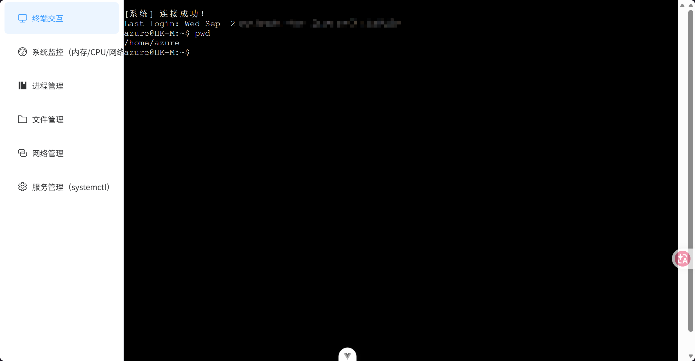
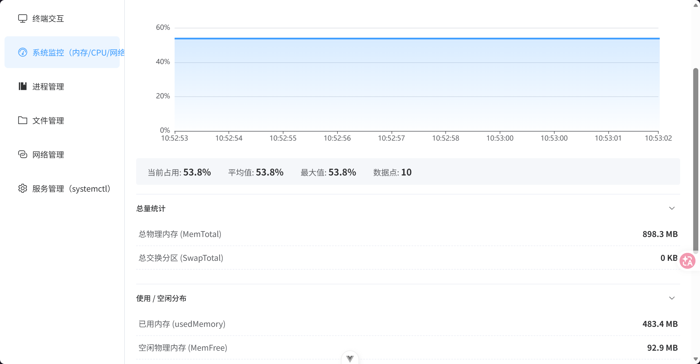
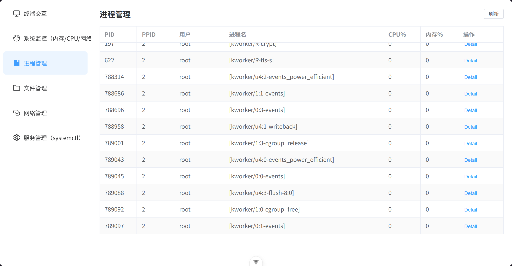
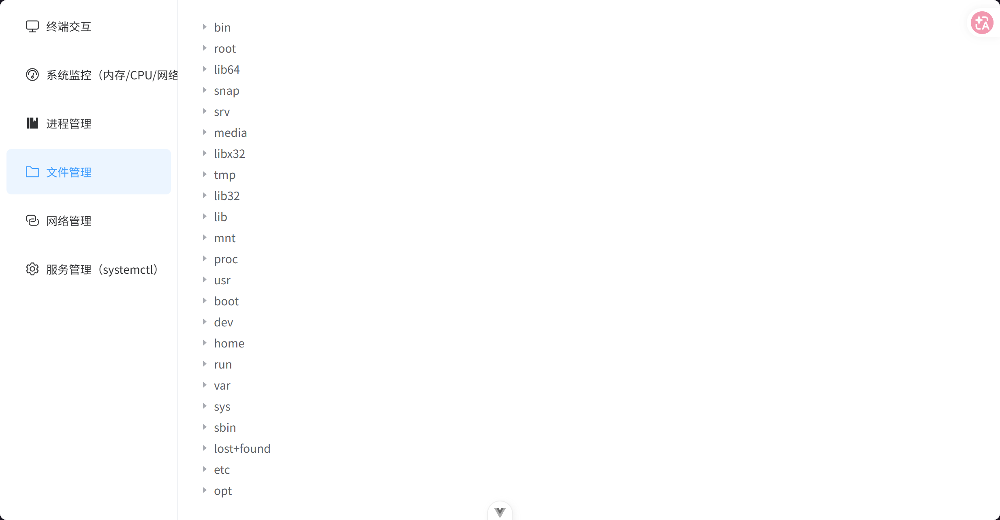
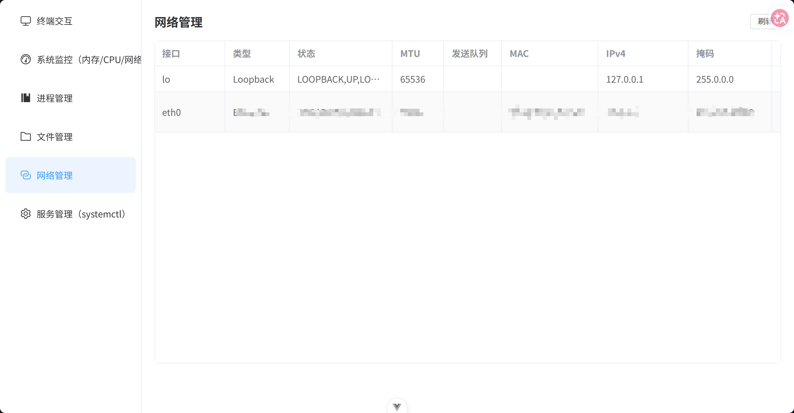
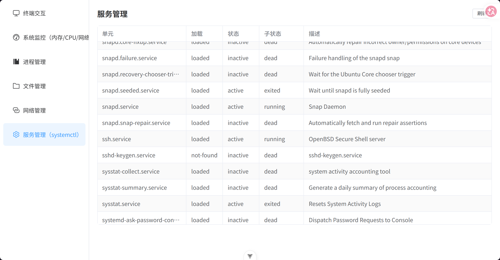
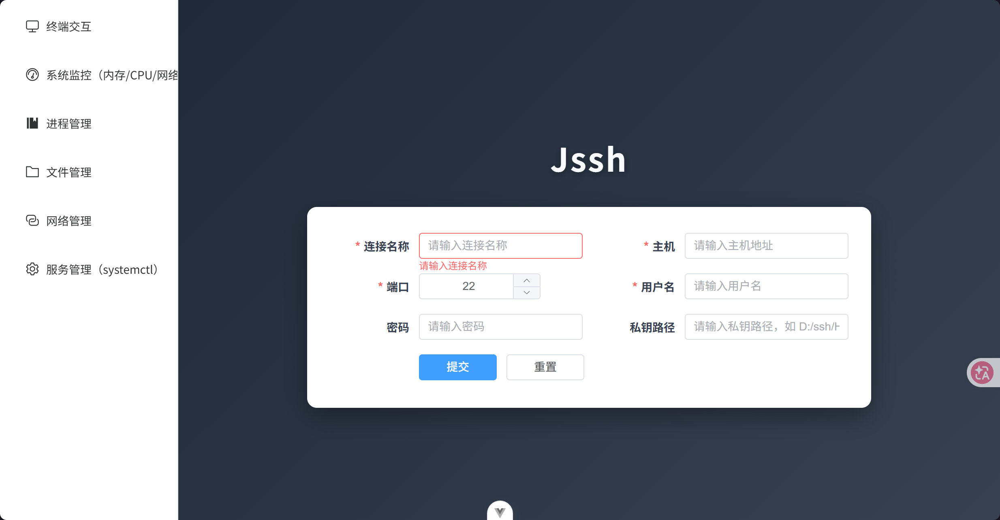

# jssh-agent

一个基于 Java 开发的 SSH 连接与服务器管理工具：通过浏览器即可连接远程主机，提供终端交互、系统监控、进程/文件/网络/服务管理能力，并内置基于大模型的 AI 运维助手。

## 徽章

[](https://opensource.org/licenses/MIT)
[](https://www.oracle.com/java/)
[](https://spring.io/projects/spring-boot)
[](https://docs.spring.io/spring-ai/reference/)
[](https://vuejs.org/)
[](https://element-plus.org/)
[](https://mina.apache.org/sshd-project/)

## 项目结构

仓库包含三个可独立构建的模块（根目录没有聚合 `pom.xml`，需分别构建）：

| 目录 | 说明 | 端口 |
| ---- | ---- | ---- |
| `jssh-back-end/` | SSH 能力后端：WebSocket 终端与监控类 REST 接口 | 8080 |
| `agent/` | AI 助手服务：多 Agent 工作流，SSE 流式对话 | 8081 |
| `jssh-front-end/` | 前端界面（Vue 3 + Element Plus） | 5173 |

```
浏览器 5173
 ├─ REST + WebSocket(/podname) → 8080 jssh-back-end → Apache MINA SSHD → 远程主机
 └─ POST /chat/stream (SSE)    → 8081 agent ──REST 调用 8080──┘
```

## 功能列表

| 功能模块 | 说明                                                     |
| -------- | -------------------------------------------------------- |
| 终端交互 | 基于 xterm + WebSocket 的实时终端，支持持久化 Shell 会话 |
| AI 助手  | 多 Agent 工作流：剖析问题 → 技术/运维/安全三路并行分析 → 汇总报告，流式输出 |
| 系统监控 | 内存占用（实时折线图）、CPU 使用率、网络流量             |
| 进程管理 | 进程列表（按 CPU / 内存降序）、进程详情查看              |
| 文件管理 | 远程目录懒加载浏览（`/proc`、`/etc` 等任意路径）         |
| 网络管理 | 网卡信息：IPv4/IPv6、MAC、MTU、RX/TX 收发统计            |
| 服务管理 | systemctl 服务单元列表（加载/激活/子状态/描述）          |
| 连接管理 | 连接参数保存与删除、私钥上传                             |

## 展示图

| 终端交互 | 系统监控 | 进程管理 |
| --- | --- | --- |
|  |  |  |

| 文件管理 | 网络管理 | 服务管理 |
| --- | --- | --- |
|  |  |  |



## 快速开始

### 环境要求

- JDK 21+（`jssh-back-end` 使用 Java 21 并开启 `--enable-preview`；`agent` 模块为 Java 17+）
- Maven 3.6+（也可直接使用仓库内置的 Maven Wrapper）
- Node.js 22.18+ 或 24.12+（前端 `package.json` 的 `engines` 约束）
- 一台可 SSH 访问的远程 Linux 主机

### 启动后端

```bash
cd jssh-back-end
./mvnw spring-boot:run      # Windows: mvnw.cmd spring-boot:run
```

后端默认运行于 `http://localhost:8080`。

> ⚠️ 必须在 `jssh-back-end/` 目录下启动。连接信息与私钥以相对路径 `../jssh-restore/` 落盘（见 `UploadServiceImpl`），在其它目录启动会把数据写到错误的位置。

### 启动 AI 助手服务（agent）

```bash
cd agent
./mvnw spring-boot:run      # Windows: mvnw.cmd spring-boot:run
```

- 运行前需在 `agent/src/main/resources/application-dev.yaml` 中配置 `spring.ai.deepseek.api-key`（默认 profile 为 `dev`）。
- 服务运行于 `http://localhost:8081`，对外提供 `POST /chat/stream`（SSE 流式对话）。
- agent 不直接建立 SSH 连接，它通过 `RestClient` 调用后端 `8080` 的接口获取数据，因此需先启动后端并完成 SSH 连接。

### 启动前端

```bash
cd jssh-front-end
npm install
npm run dev
```

前端默认运行于 `http://localhost:5173`，打开浏览器访问即可。接口地址通过 `jssh-front-end/.env` 中的 `VITE_API_BASE_URL`（默认 `http://localhost:8080`）配置。

### 建立连接

1. 打开前端页面，在连接表单中填写远程主机的**主机地址、用户名、密码或已上传的私钥**；
2. 点击提交（后端 `POST /base/connect` 建立并保持 SSH 会话）；
3. 连接成功后即可使用侧边栏的终端、AI 助手、监控、进程、文件、网络、服务管理等功能。

## 安装与使用

### 系统依赖

后端 SSH 能力由 [Apache MINA SSHD](https://mina.apache.org/sshd-project/) 提供，无需外部 SSH 客户端。agent 基于 Spring AI + spring-ai-alibaba-agent-framework。前端使用 Vue 3 + Element Plus + xterm + ECharts。

### 连接信息与密钥存储

- 连接成功后，连接参数以 Properties 形式写入 `jssh-restore/connection/<连接名>.txt`（**密码为明文**，请注意保护）；
- 通过 `POST /uploadKey` 上传的私钥写入 `jssh-restore/key/<uuid>.pem`，接口返回该文件的绝对路径，将其作为 `privateKeyPath` 提交即可；
- `jssh-restore/` 已被 `.gitignore` 忽略，请勿将其提交到仓库；
- 配置项 `ssh.connect.*` 目前仅被测试用例 `jssh-back-end/src/test/java/com/myr/test/ClientTest.java` 读取，主流程不使用。

### 接口说明

| 方法 | 路径 | 说明 |
| ---- | ---- | ---- |
| POST | `/base/connect` | 建立 SSH 连接（`ConnectParam`） |
| GET | `/connection` | 已保存连接列表 |
| DELETE | `/connection/{connectName}` | 删除已保存连接（连同其私钥） |
| POST | `/uploadKey` | 上传私钥（multipart `file`），返回落盘路径 |
| GET | `/memory` | 内存信息 |
| GET | `/process` | 进程列表 |
| GET | `/network` | 网卡信息 |
| GET | `/system` | systemd 服务单元列表 |
| GET | `/file?path=/` | 目录懒加载（单层） |
| GET | `/file/download` | 下载远程文件 |
| WS | `/podname` | 终端 WebSocket |
| POST | `/chat/stream` | AI 助手流式对话（SSE，agent 服务，端口 8081） |

### 使用示例

```bash
# 1) 上传私钥，拿到后端落盘路径
curl -F "file=@$HOME/.ssh/id_rsa" http://localhost:8080/uploadKey

# 2) 建立连接（password 与 privateKeyPath 至少填写一个）
curl -X POST http://localhost:8080/base/connect \
  -H "Content-Type: application/json" \
  -d '{"connectName":"test","host":"192.168.1.100","port":22,"user":"root","privateKeyPath":"<上一步返回的路径>"}'

# 3) 查询内存 / 服务单元列表
curl http://localhost:8080/memory
curl http://localhost:8080/system

# 4) 浏览根目录
curl "http://localhost:8080/file?path=/"

# 5) 向 AI 助手提问（流式输出）
curl -N -X POST http://localhost:8081/chat/stream \
  -H "Content-Type: application/json" \
  -d '{"message":"检查服务器当前的进程与内存情况"}'
```

## 贡献指南

欢迎提交 Issue 与 Pull Request。参与前请先阅读 [CONTRIBUTING.md](./CONTRIBUTING.md)（如有）。基本流程：

1. Fork 本仓库；
2. 创建特性分支 `git checkout -b feature/xxx`；
3. 提交改动 `git commit -m 'feat: xxx'`；
4. 推送到远端 `git push origin feature/xxx`；
5. 发起 Pull Request。

## 许可证

本项目基于 [](https://opensource.org/licenses/MIT) 开源。
